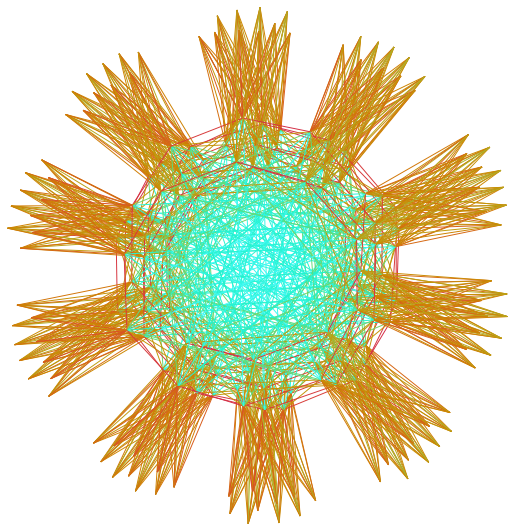

# (Free and) Open Source

---

I believe in free and open source software (FOSS), so I dedicate a significant amount of time and effort to this end.

Here is the project I'm the most proud of:

### visla
<table style="width:100%">
  <tr>
    <td width="30%"></td>
    <td>
      

        <!-- cannot rely on markdown rendering inside of HTML environment -->
        <a href="https://github.com/ghbrown/visla" target=_blank>visla</a>
        renders stunning visualizations of sparse matrices and graphs with ease.
      

    </td>
  </tr>
</table>

Here are some projects I've contributed to:

### Chapel

- The [Chapel programming language](https://chapel-lang.org/) is designed for parallel computing at scale.
  I contributed multiple routines to modules like `LinearAlgebra.chpl`, and previously packaged the compiler for Arch Linux.

### fortran-lang

- [fortran-lang](https://fortran-lang.org/en/) is a community effort to polish and modernize the Fortran programming language.
  Efforts include a [package manager](https://fpm.fortran-lang.org/) and a [standard library](https://stdlib.fortran-lang.org/) (to which I've contributed routines for linear algebra).

### pyttb

- [pyttb](https://github.com/sandialabs/pyttb), the "Python Tensor Toolbox", provides data structures and algorithms for tensor computations.
  I contributed a visualizer and significantly accelerated another function.

### nixpkgs
- [nixpkgs](https://github.com/NixOS/nixpkgs) is the official package collection for the NixOS Linux distribution.
  I contributed a small fix for one of the packages.

### EndeavourOS

- I've contributed bug fixes to configurations for the [i3 window manager](https://i3wm.org/i3) version of the [EndeavourOS](https://endeavouros.com/) Linux distribution.

### beets

- [beets](https://beets.io/) organizes local music collections, including autotagging and so much more.
  I contributed an interface to match single tracks using Discogs.

---
